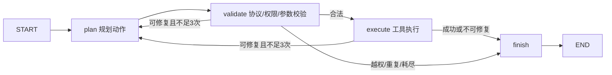

# 10.22 智能体改造设计

目标：以测评数据驱动商城客服、销售问数、营销场景三类能力的可靠性改造。现有 v1 是新建的教学基线，并非用户原有线上商城；v2 是可运行 LangGraph 原型。

## 状态与节点

状态包含 case、provider、attempt、raw、action、output、error、status、trace、seen。节点只返回部分更新。

三次是**总尝试次数**，即首次加最多两次重试；使用明确计数避免把重试三次误写成总共三次。参数合法但执行失败的相同动作再次出现时提前终止；结构本身不合法的输出最多尝试三次。模型服务失败明确返回 provider_error，不伪装成功。

## 按能力改造

| 能力 | v1 缺陷 | v2 修改 | 对应证据 |
|---|---|---|---|
| 客服 | 代码围栏不能解析，工具无能力边界 | 围栏去除后严格 JSON；客服只允许检索、引用上下文、转人工 | customer-markdown、customer-injection |
| 问数 | 错误字段一次失败即终止 | 将数据库错误反馈到下一规划；最多三次尝试 | data-repair |
| 场景 | 缺字段不会重试，可能调用不相关工具 | Pydantic 约束角色与步骤数量，错误反馈，能力白名单 | scene-schema、scene-boundary、scene-loop |

工具层：商品参数化查询；销售仅允许 sales 表、SELECT 和白名单聚合函数。SQLite authorizer + query_only + 指令预算 + 最大 100 行构成四层边界。转人工只返回沙箱结果，不发送真实通知。

## 文件与原因

| 文件 | 职责及修改原因 |
|---|---|
| app/agent.py | 将单次调用与 v2 状态图放在同一入口下，便于相同用例对比 |
| app/tools.py | 统一参数 Schema、能力权限及只读 SQL，避免提示词成为唯一安全边界 |
| app/providers.py | 隔离回放和真实 Qwen；统一模型接入，不将参考答案发送给模型 |
| app/evaluation.py | 固定数据集校验、指纹、逐条断言、耗时与结果快照 |
| app/design.py | 三份方案绑定同一版本用例，设计可追溯到测试证据 |
| app/judge.py | 语义评分 1-5 锚点与真实人工 MAE 校准，独立于规则成绩 |
| web/ | 两项作业页面、五维统计、筛选、执行详情及 JSON 导出 |

## 验收与后续

当前回放 15/15、断言 28/28、测试 31 通过。安全测试覆盖写入、PRAGMA、ATTACH、多语句、其他表读取和扩展函数。固定样例只能覆盖已枚举故障，不证明未知攻击全部安全。

仍需真实模型多轮采样、人工 Judge 校准、持久化身份与会话、线上认证和日志脱敏后才能作为实际商城服务部署。营销场景当前校验结构，不宣称能自动判定所有文案业务质量。
