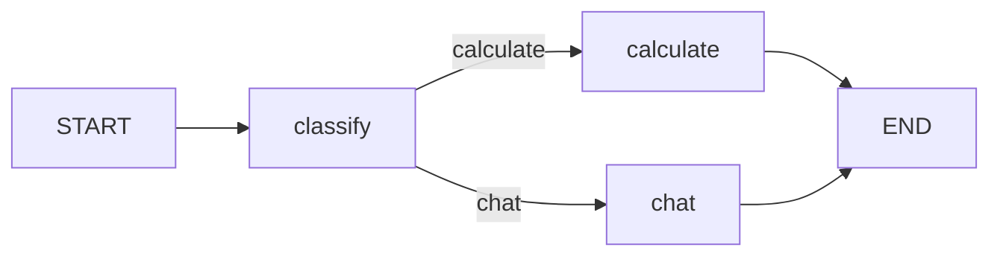

# 模块三至六：LangGraph 完整作业

2026-10-13 更新：新增智能问数助手、updates/values/custom三种流式输出、文章子图、客服子图，共6项，现累计26个示例。运行命令使用纯文本文件 [本次六项截图命令](本次六项截图命令.txt)，避免从表格复制时带入反引号。入口为 examples/class25 至 class30；共享实现位于 smart_query_core.py 与 stream_subgraph_core.py。`run_project.py` 实际执行本次6项并记录输出。

问数数据库采用三张课程示例表，运行时明确打印日期范围。基于SQLite只读连接及数据库自身的语法/字段检查，SQL修正后直接重新验证，最多修正3次。内置三个示例校验金额基准，任意新问题仍需要使用者核对语义是否符合预期。数据文件在data/，不会随代码包上传。部署讲义作为扩展参考，本次实现截图所列的六项终端模块。

最新参考图修订：请以 [参考图逐项截图命令](参考图逐项截图命令.md) 为准。已新增五种图结构编译验证、简单/复杂问答路由、SQLite答案读档，完善客服人工审核流程、三主题写诗与并行综合摘要。现共20个编号示例，对应参考表格的11个截图栏目。

2026-10-08 新增图片中的八项：人机交互、智能客服改造、检查点、持久化、条件边、循环、并行、带路由的智能客服。项目现共17项。逐项运行和截图命令见 [本次八项运行说明](本次八项运行说明.md)。新增项已真实运行，全部22项单元测试通过。

新增文件为 examples/10 至 examples/17，公共图定义位于 examples/advanced_graphs.py。`run_advanced.py` 只运行本次八项；`run_all.py` 运行全部17项。批量模式会明确显示测试审批输入，交互脚本默认等待用户输入 yes/no。

依据提供的两份 PDF 和图片完成九个模块。第六、七、九项真实调用千问，需要配置密钥；其余模块直接运行真实的 LangGraph 节点。

| 图片要求 | 实现文件 |
|---|---|
| 有向图与 LangChain | examples/01_graph_and_langchain.py |
| 状态设计 | examples/state_model.py、examples/02_state_design.py |
| 自然语言描述 StateGraph 结构 | examples/03_stategraph_structure.py |
| Hello World | examples/04_hello_world.py |
| 多节点输出 | examples/05_multiple_nodes.py |
| 在节点中调用 Qwen | examples/06_langgraph_qwen.py |
| 条件边 | examples/07_conditional_edges.py |
| 图的构建与编译 | examples/08_compile_graph.py |
| Checkpointer 与状态历史 | examples/09_checkpointer_demo.py |

## 当前电脑运行

在 PowerShell 中逐行运行，每组输出后可以自行截图，下一组前用 `cls` 清屏：

```powershell
cd D:\Codex\2026-09-20\langgraph-core
$env:PYTHONIOENCODING = "utf-8"
.\.venv\Scripts\python.exe .\examples\01_graph_and_langchain.py
.\.venv\Scripts\python.exe .\examples\02_state_design.py
.\.venv\Scripts\python.exe .\examples\03_stategraph_structure.py
.\.venv\Scripts\python.exe .\examples\04_hello_world.py
.\.venv\Scripts\python.exe .\examples\05_multiple_nodes.py
.\.venv\Scripts\python.exe .\examples\06_langgraph_qwen.py
.\.venv\Scripts\python.exe .\examples\07_conditional_edges.py
.\.venv\Scripts\python.exe .\examples\08_compile_graph.py
.\.venv\Scripts\python.exe .\examples\09_checkpointer_demo.py
```

全部17项运行并保存日志：`.\.venv\Scripts\python.exe run_all.py`。
运行全部测试：`.\.venv\Scripts\python.exe -m unittest discover -p "test_*.py"`。
真实运行日志在 `runs/`，没有合成截图。

新电脑安装 Python 3.11+ 和 uv 后，在项目目录执行 `uv sync`，再执行 `uv run python run_all.py`。压缩包不包含虚拟环境。

首次运行千问示例：复制 `.env.example` 为 `.env`，填写自己的 `LLM_API_KEY`，默认模型 `qwen-plus`。当前电脑已使用先前配置的密钥，无须重填。`.env` 不提交 GitHub，也不放进压缩包。

## 新增两项模块

第六项路径：`START -> ask_qwen -> END`。节点从状态读取 user_query，调用千问，将回复写入 results 并追加到 message，终端显示用户问题、模型回答及最终结果。

第七项使用 `add_conditional_edges`，由千问返回 calculate 或 chat 分类：



计算分支提取算式后用 AST 白名单实际计算，支持数字、括号和加减乘除，不使用 eval。聊天分支调用千问回复。演示依次运行问候语和“计算 25 × 4 + 100 等于多少”，后者结果应为 200。终端打印实际访问的节点；错误分类或接口失败会报错，不会退回假回复。

本机 uv 位于 `D:\Codex\tools\bin\uv.exe`。重新安装时将 `UV_CACHE_DIR` 设为 `D:\Codex\cache\uv`，`TEMP` 和 `TMP` 设为 `D:\Codex\temp`，让缓存和临时文件保留在 D 盘。

## 模块四：编译与 Checkpointer

第八项按图片注册 `add_info` 和 `print_info`，连接 `START -> add_info -> print_info -> END`，调用 `compile()` 后分别演示 `invoke`、`ainvoke` 和 `astream`。`add_info` 写入 output，`print_info` 读取并打印结果。空更新节点在流中可能显示为 None。

第九项使用 `question`、`draft`、`answer` 三个状态字段。千问先生成初稿，再根据初稿润色；`compile(checkpointer=InMemorySaver())` 配合 `configurable.thread_id` 保存同一流程的检查点。`get_state_history(config)` 从新到旧打印完整状态。本机版本实际产生四条记录，最后一条为空的输入检查点，前三条对应图片中的答案、草稿、问题。

暂停与继续的演示命令：

```powershell
.\.venv\Scripts\python.exe .\examples\09_checkpointer_demo.py --pause
```

该模式先在润色节点前暂停，打印已有草稿及待执行节点，再在同一进程使用 `invoke(None, config)` 继续，初稿节点不会重复执行。InMemorySaver 只在当前进程内保存数据，关闭程序后不会保留历史；不同 thread_id 的状态相互隔离。

新增四项测试覆盖历史内容与会话隔离、暂停续跑、新建内存存档为空，以及同步/异步输出和流式节点顺序。测试使用替身模型避免消耗 API，示例运行日志来自真实千问请求。参考：[LangGraph 状态持久化文档](https://docs.langchain.com/oss/python/langgraph/persistence)。

## 状态字段

```python
from operator import add
from typing import Annotated, TypedDict

class State(TypedDict):
    message: Annotated[list[str], add]
    user_query: str
    results: str
```

字段名与图片一致。message 是列表，框架自动追加节点的新消息；user_query 保存原始输入；results 是字符串，在顺序执行中后写入的值覆盖前值。节点只返回修改的字段；没有返回的字段保留。

节点应返回新增消息，不能重复返回整个历史列表，否则 add 会重复追加。TypedDict 仅描述类型，不提供运行时验证或默认值。另提供讲义中的 WeatherState 类型设计，不编造天气查询结果。

## 自然语言描述图结构

用户输入保存在 user_query。图从 START 进入 analyze 节点，去除输入首尾空格，把处理结果存入 results，并向 message 追加过程记录。generate 节点随后读取 results，将它转换成大写，再追加自己的记录，最后到 END。读取 results 得到最终结果，读取 message 可以查看完整过程。

先用 StateGraph(State) 创建构建器，再用 add_node 注册节点、add_edge 连接执行顺序；compile() 生成可执行图；invoke(initial_state) 返回最终状态。stream(..., stream_mode="values") 可以逐步观察合并后的状态。


多节点扩展顺序：`START -> hello -> process -> goodbye -> END`。

## 概念说明

- 有向图可以有环；DAG 专指有向无环图。循环需要退出条件。
- LangChain 提供模型、工具及 Runnable 等组件；LangGraph 通过显式状态、节点和边控制流程，二者可以结合。
- 讲义的 Hello World 是最小工作流图，不是自主决策智能体，无需大模型也可以真实执行。
- Hello World 和双节点示例的 message 是字符串，体现覆盖；图片中的 message 是列表，体现追加。两个类型分别定义，不混用。
- 修改构建器不会自动改变已编译图，修改结构后应重新编译。编译检查不能代替循环退出条件设计。
- 反向连接 goodbye 到 hello 的行为取决于完整图结构，不是必然报错。

## 实际验证

前五项的六项测试检查链与图结果一致、消息追加、保留未修改字段、初始输入不变、Hello World、节点顺序和字符串覆盖。新增三项测试验证计算器、两条条件路径和错误分类，单元测试不消耗 API；运行示例的原始在线输出在 runs 中。

Python 3.12.14；langgraph 1.2.11；langchain-core 1.6.3。依赖由 uv.lock 锁定。

参考：提供的 PDF 第 9–12 课时；[LangGraph 官方文档](https://docs.langchain.com/oss/python/langgraph/graph-api)。
