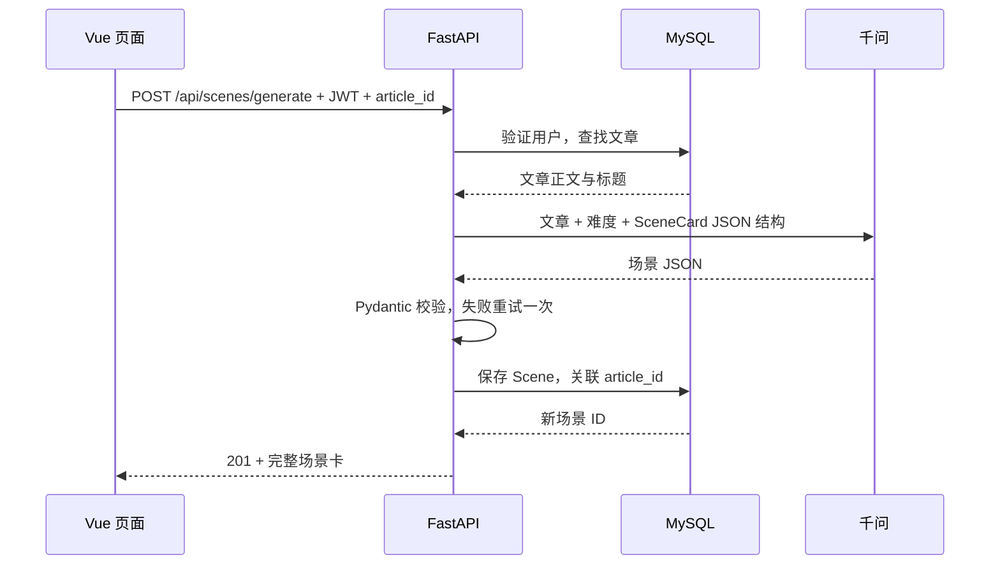

# 文章和场景数据调用流程

## 文章查询

前端带 JWT 调用 GET /api/articles → 登录依赖验证令牌并查用户 → get_db 为本次请求提供 AsyncSession → 按页从 MySQL 读取文章摘要 → Pydantic 序列化 → 页面显示列表。选中条目后 GET /api/articles/{id} 读取完整正文，找不到返回 404。

## 场景生成

API 密钥只在后端读取。校验失败不会写入场景表。数据库读取事务在等待模型前提交，减少长时间占用连接。

## 场景查询与会话

GET /api/scenes?article_id=... 查询文章已有场景；GET /api/scenes/{id} 从数据库加载卡片，**不会再次调用模型**。

进入场景：POST /api/sessions 校验 article_id 和 scene_id 匹配，以 JWT 中的用户 ID 创建或复用会话。发送消息时先校验归属、保存用户消息，读取最近 10 条消息和场景设定，然后调用 Qwen，保存回复并返回。失败时用户消息保留。其他用户请求同一会话返回 404。

这与“数据库会话”不同：AsyncSession 是每次 HTTP 请求的数据库访问对象；sessions 表记录的是跨多次请求持续存在的学习会话。
